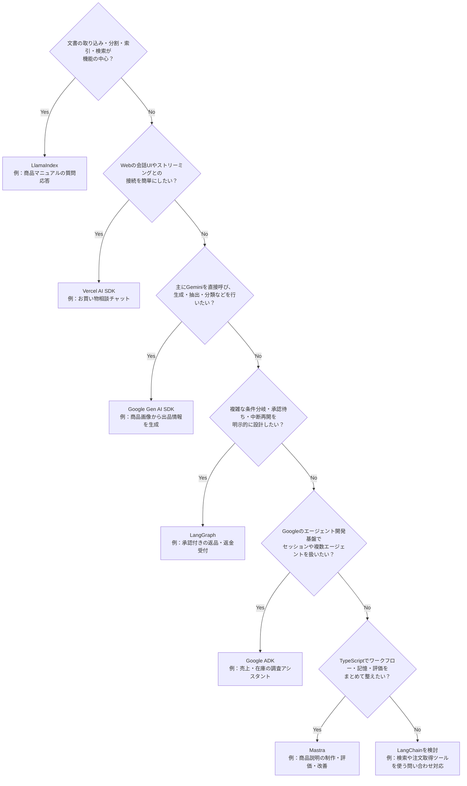

# ADR 0001: AI SDK・フレームワークの選定指針

- 日付: 2026-10-28
- 状態: 選定指針として記録

## 背景

プロダクトにAI機能を実装する際、各SDK・フレームワークに何を任せたいかによって選択する。
このリポジトリで扱う7種類の候補を、主目的に沿ってYes／Noで絞れるようにする。

## 決定

以下の分岐を候補選定の目安として使う。複数の条件に当てはまる場合は、組み合わせて利用することも検討する。
各ツールの担当範囲は重なっているため、分岐は得意分野を基にした選定指針とする。

図中の題材は使いどころの例。現在のサンプルの機能は[サンプル一覧](../examples/README.md)と[比較アプリのガイド](../docs/framework-lab.md)を参照する。

## 適用方法

- 会話画面はAI SDK、文書検索はLlamaIndexのように、異なる担当範囲を組み合わせる。
- Vertex AIなどのモデル提供基盤は、この図のSDK・フレームワーク選定と分けて考える。
- 最後のLangChainへの分岐も候補として扱い、必要なツール連携や実行制御が合うかを確認する。

## 公式資料

- [LlamaIndex](https://developers.llamaindex.ai/typescript/framework/)
- [Vercel AI SDK](https://ai-sdk.dev/docs/introduction)
- [Google Gen AI SDK](https://github.com/googleapis/js-genai)
- [LangChain / LangGraph](https://www.langchain.com/oss-overview)
- [Google ADK](https://adk.dev/)
- [Mastra](https://mastra.ai/docs)
